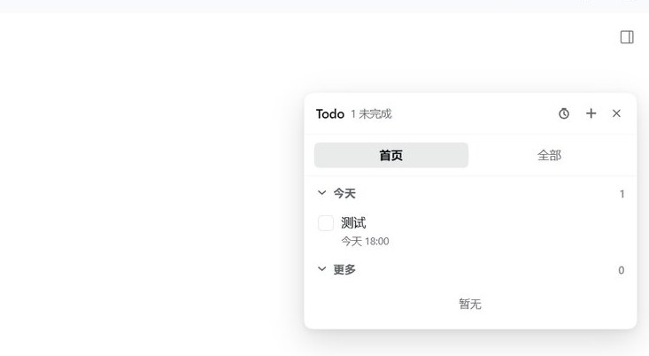
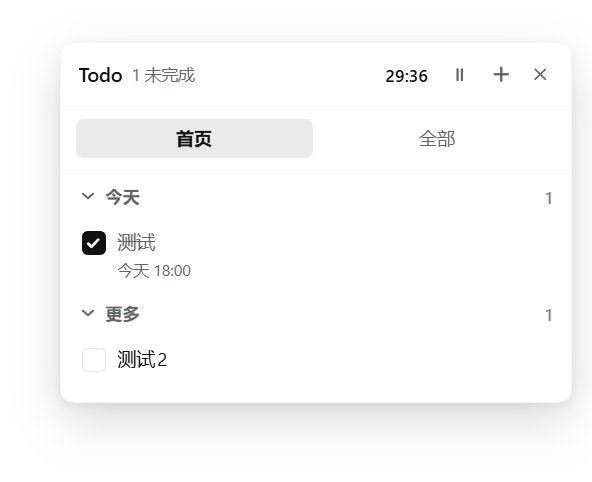
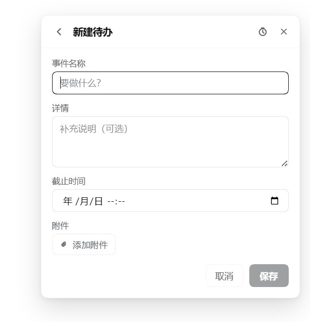
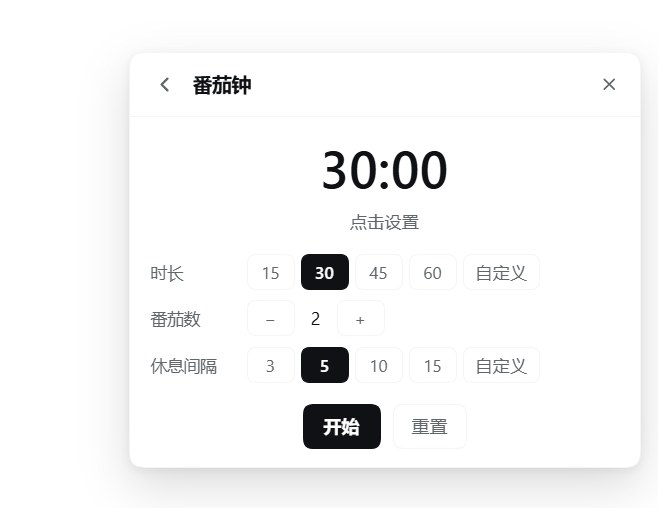

# dsh-better-todo

[](https://www.npmjs.com/package/dsh-better-todo)
[](LICENSE)

[English](README.md) | 中文

一个挂在 DeepSeek Harness Web UI 右侧的待办面板：悬浮在窗口之上，拖到哪边就吸附到哪边，标题栏里还带一个番茄钟。



## 功能

- **悬浮面板 + 四边吸附** —— 拖标题栏移动，松手后自动贴到最近的窗口边缘（左/右/上/下），不会停在半截出屏的位置；双击标题栏复位。
- **侧边栏入口** —— 设置按钮旁有一行 `Todo`，右侧显示还没完成的条数；面板开着还是关着会被记住。
- **两个视图** —— `首页` 按 **今天**（今天到期）和 **更多**（其余，含没设截止时间的）分组，两组都能折叠；`全部` 分 **未完成** 和 **已完成**，已完成先展示 10 条，每次「展示更多」再加 20 条。
- **先看后改** —— `+` 打开新建页，填名称、详情、截止时间和一个附件。点条目先进只读详情页，什么都不改不了；点右上角 **编辑** 才进入表单。
- **附件按类型处理** —— 图片附件点击直接全屏放大（点背景或按 Esc 关闭），其他文件点击则下载。
- **番茄钟** —— 标题栏的时钟打开计时页：专注时长（预设 15 / 30 / 45 / 60 分钟，也可以手填 1–180 之间的任意分钟）、番茄数（1–12）、休息间隔（预设 3 / 5 / 10 / 15，也可以手填 1–120）。倒计时一直显示在标题栏那块，正在走的时候旁边还有一个**暂停 / 继续**按钮，点一下冻住当前剩余时间，再点接着走。
- **到点先通知，你点了才进下一段** —— 专注或休息结束时不自动切换：计时停在原地，面板里弹出提示条（面板关着会自动打开），Windows 上再推一条系统通知；你点「开始休息」或「开始专注」才进入下一段，点「稍后」可以先把提示条收起。
- **中英双语** —— 跟随应用的界面语言切换。
- **agent 能读也能改** —— 插件给 agent 注册了 `todo_list` / `todo_add` / `todo_update` / `todo_remove` / `todo_attach`，所以「把这条勾掉」「加个备注」「把这张截图挂上去」都能用说的；改完面板几秒内自己同步。
- **输入框里的 `/todo`** —— 手快的话直接打字：`/todo` 看列表、`/todo add 写周报`、`/todo finish 3`。固定规则解析，不花模型调用。
- **重启不丢** —— 条目、附件、面板位置、番茄钟设置都写进 `~/.dsh/todo-panel/` 下的一个 JSON 文档，由插件的宿主半边落盘，不上传任何地方。

## 截图

| 列表 | 新建待办 | 番茄钟 |
| --- | --- | --- |
|  |  |  |

## 安装

```sh
dsh plugin --profile web add https://github.com/lewisyoung0914/dsh-better-todo
```

然后重启 `dsh web`（或桌面端）并刷新页面。等插件上了市场之后，也可以按包名安装：

```sh
dsh plugin --profile web add dsh-better-todo
```

需要提供 `shell.overlay` 与 `sidebar.footer.action` 两个前端槽位的 DSH 版本（开发验证于 `0.2.1-rc.3`）。

## 用法

| 操作 | 位置 |
| --- | --- |
| 打开/关闭面板 | 侧边栏底部的 `Todo` 一行 |
| 移动面板 | 拖标题栏，松手吸附到最近边缘 |
| 复位位置 | 双击标题栏 |
| 新建待办 | 面板右上角 `+` |
| 编辑待办 | 点这条待办的文字 |
| 完成待办 | 左侧的勾选框 |
| 打开番茄钟 | 面板标题栏的时钟（或正在走的倒计时） |
| 暂停/继续倒计时 | 倒计时旁的 ⏸ / ▶ |
| 不动鼠标管理清单 | 输入框里打 `/todo` |

番茄页里，`开始` / `暂停` 控制当前阶段，`重置` 回到待机并清零计数。设置只在待机时可改，避免倒计时中途跳变。

## 通知

阶段结束时做两件事，保证你不会错过：

1. 面板里弹出提示条（面板关着会自动打开），带「开始休息 / 开始专注」和「稍后」两个按钮；
2. 推一条 Windows 系统通知。

系统通知优先用页面的 `Notification` 接口；用不了（没授权、或宿主环境不支持）就退回由插件宿主半边调 PowerShell 发 toast。第一次点 `开始` 时会申请权限。

已知限制：

- 窗口长时间最小化时，Chromium 会限制定时器频率，到点最多可能晚一分钟左右；窗口重新可见时会立即补检。
- Windows 的「专注助手 / 勿扰」会拦掉 toast，这不在插件能控制的范围内。
- 权限被拒又不想改，面板内的提示条仍然有效。

## 让 agent 读写待办

插件的宿主半边注册了一组工具，装好插件后任何对话都能用。

读：

| 工具 | 参数 | 说明 |
| --- | --- | --- |
| `todo_list` | `status`：`all`（默认）/ `open` / `done`；`limit`：1–200，默认 100 | 返回标题、详情、截止时间、完成状态、附件名 |

写（都会直接改你的清单，改完面板几秒内自动同步）：

| 工具 | 参数 |
| --- | --- |
| `todo_add` | `title`（必填）、`detail`、`due` |
| `todo_update` | `id`（必填）+ 想改的 `title` / `detail` / `due` / `done`（`done` 用来勾掉或恢复） |
| `todo_remove` | `id`（必填） |
| `todo_attach` | `id`（必填）、`path`（本机文件路径，最大 32 MB）—— 图片就是「加截图」，其他文件同样可以挂上去 |

所以你直接说「把测试智创工作台勾掉」「给这条加个备注：等接口联调」「把这张截图挂到第 4 条」就行。

同步是靠文档里的 `rev` 修订号：面板保存时带上自己看到的版本，宿主发现已经变过就返回 409，面板合并后再写一次；面板空闲时每 4 秒拉一次，所以 agent 改完你能看到它出现。

新加的工具在插件加载时注册，所以装完或改过 `index.js` 之后需要重载插件（设置里的插件列表关掉再打开）或重启 DSH。

## 斜杠命令

上面的 `todo_*` 是**给 agent 用的工具**，输入框的 `/` 菜单列的是**命令**，两套注册表，所以工具不会出现在 `/` 里。想在输入框直接操作清单，用插件注册的 `/todo`：

| 输入 | 作用 |
| --- | --- |
| `/todo` | 未完成的条目（带序号和 id） |
| `/todo all` | 全部条目 |
| `/todo done` | 已完成的条目 |
| `/todo add 写周报` | 新增一条；想同时填详情和截止时间就写 `/todo add 写周报 \| 下午写 \| 2026-11-07T18:00` |
| `/todo finish 3` | 把第 3 条勾掉（也可以写 id 或 id 前缀） |
| `/todo undo 3` | 取消勾选 |
| `/todo remove 3` | 删除（附件一起清） |

除了子命令，也认日常说法：`/todo 新增 把 gzcode 放到内网测试`、`/todo 完成 3`、`/todo 删掉 2`、`/todo 已完成`。整句写也没有关系——`/todo 今天新增一条任务，把gzcode放到内网测试` 会把开头那串语气和动词去掉，存成「把gzcode放到内网测试」。

命令是**固定规则解析**，不做语义理解：想让它「读懂」复杂的话（比如「把第三条改到明天下午，再加个备注」），直接发一句正常消息给我，我会调 `todo_*` 工具去做，别打 `/`。

命令的改动同样走 `rev` 修订号，面板几秒内自动同步；命令的返回结果直接显示在对话里，不消耗模型调用。

## 数据

所有内容都在插件宿主半边持有的一个 JSON 文件里：

```
<DSH_HOME>/todo-panel/state.json      # 默认 ~/.dsh/todo-panel/state.json
```

页面通过自己源上的 `/todo-panel/state` 读写它。绕这一圈是必要的：桌面端每次启动都会重新分配 Web 端口，而 `localStorage` / IndexedDB 按源隔离，把待办放在浏览器里意味着重启后就是另一个空库。

| 字段 | 内容 |
| --- | --- |
| `rev` | 修订号，每写一次加一；页面靠它发现别人改过 |
| `savedAt` | 最后一次落盘的时间戳 |
| `items` | 名称、详情、截止时间、完成状态、附件信息 |
| `open` | 面板是否打开 |
| `position` | 面板位置与吸附的边 |
| `pomodoro` | 番茄钟设置与正在进行的阶段 |
| `attachments` | 按条目 id 存放的文件 data URL |

文件就是普通 JSON：可以直接备份、查看或删除。它按 profile 隔离，与 DSH 账号无关，也不会离开本机。仍留着旧版数据的浏览器会话会在首次加载时自动迁移并清掉旧键。

宿主半边还提供两个页面自用的接口：`/todo-panel/state`（读写文档）和 `/todo-panel/notify`（发 Windows toast），都只接受同源请求。

## 开发

没有构建步骤，插件就是一个普通的 ES 模块。

| 文件 | 作用 |
| --- | --- |
| `index.js` | 宿主半边：JSON 文档与 `rev` 协议、`/todo-panel/state` 与 `/todo-panel/notify`、5 个 agent 工具、`/todo` 命令 |
| `client.js` | 全部界面：状态存储、面板、详情/编辑页、番茄钟引擎、通知、样式 |
| `cordis.patch.yml` | 这个 bundle 往 profile 里插的那一行 |
| `locale/zh.json`、`locale/en.json` | 市场元数据（标题、描述） |
| `icon.svg` | 插件图标 |

没有 JSX：组件用 `React.createElement`（别名为 `h`）手写。改 `client.js` 会被运行中的应用热加载；改 `index.js` 需要重载插件（插件列表里关掉再打开），改 `cordis.patch.yml` 或 `package.json` 需要重新安装 bundle。

## 更新记录

- `1.6.7` —— 每次写入都把上一版留成 `state.json.bak`，一次坏的保存最多退一代，不会丢整份列表。
- `1.6.6` —— 面板路由、`/todo` 和 5 个 agent 工具改为通过 `ctx.inject` 注册，profile 把插件排在 Host 的 web server 与注册表之前时不会再一起失效。
- `1.6.5` —— 加了截图（面板、新建待办、番茄钟），并附 `screenshots.json` 供市场详情页使用。
- `1.6.4` —— 改由 GitHub Actions 通过 Trusted Publishing 发布到 npm，每个 tarball 附带 provenance 签名。
- `1.6.3` —— 番茄钟页面去掉了「测试通知」按钮。
- `1.6.2` —— 两份 README 按 agent 工具、`/todo` 和番茄钟重写了一遍。
- `1.6.1` —— `/todo` 认日常说法（新增/完成/删掉/已完成等），整句也能直接存成任务。
- `1.6.0` —— 新增 `/todo` 斜杠命令。
- `1.5.0` —— agent 可写（新增/修改/删除/挂附件）、`rev` 修订号协议、番茄钟到点等待点击、标题栏暂停按钮、宿主 PowerShell toast。
- `1.4.0` —— `todo_list` 工具，agent 可读清单。
- `1.3.0` —— 点条目先看只读详情、右上角「编辑」才可改；图片附件全屏查看。
- `1.2.0` —— 数据改由宿主半边落盘（此前放在浏览器里，桌面端换端口就丢）。
- `1.1.1` —— 修正客户端模块 id，解决启动时的重复注册错误。

## 许可证

MIT
